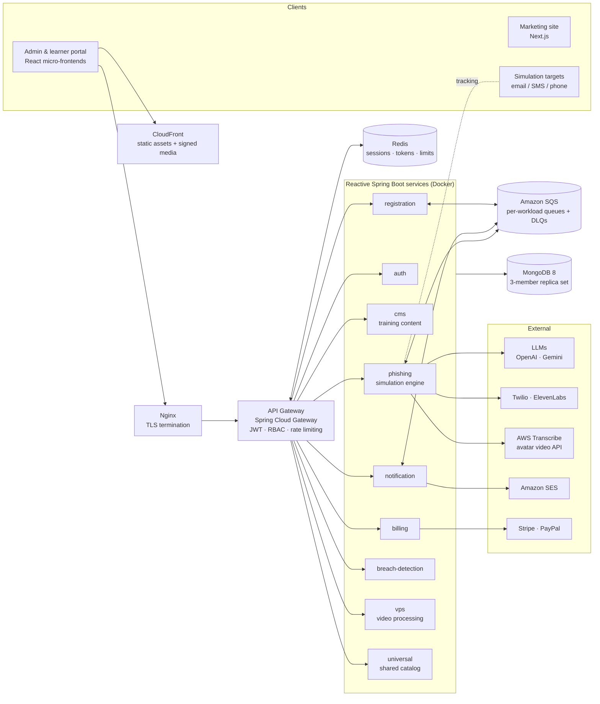
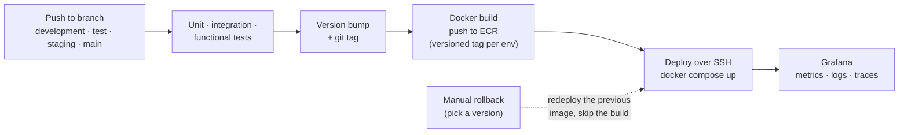

# Security-Awareness Training Platform: Architecture Case Study

> **What this is:** a write-up of a production SaaS platform that I lead as **Senior Software Engineer (Team Lead)** at Aspire Tech Services and Solutions, built for a US-based client.
> **What this is not:** source code. The code is proprietary, so this repository only documents the architecture, my decisions, and my ownership. Names, hostnames, and identifiers have been left out.

**My role:** I lead a team of 5 engineers. I own the backend architecture, I'm the top contributor to the backend codebase, and I built nearly all of the infrastructure as code, the server setup, and the CI/CD. I set the API contracts for the frontend team and mentored them on the micro-frontend architecture.

**Stack:** Java 17 · Spring Boot 3.3 (WebFlux) · Spring Cloud Gateway · MongoDB 8 (replica set) · Redis · Amazon SQS · AWS (SES, S3, CloudFront, ECR, Transcribe, KMS, SSM, Secrets Manager, Route 53, ACM) · Terraform · Docker Compose (previously EKS) · Nginx · GitHub Actions · Prometheus · Loki · OpenTelemetry · Grafana · k6 · React + TypeScript (Module Federation) · Next.js

---

## 1. The product

Companies use the platform to train employees to recognize social-engineering attacks, and to measure how vulnerable each employee is.

- **Simulations:** realistic phishing campaigns over **email, SMS, and voice calls**, plus deepfake video. Tracking measures who opens, clicks, submits credentials, or responds.
- **Training:** courses, exams, certificates, and micro-content assigned based on how each employee behaves.
- **Risk scoring:** per-user and per-organization risk scores built from simulation results, used in client security reports.
- **Breach monitoring:** watches for exposed credentials, exposed IPs, and company impersonation.
- **Commercial:** licenses, packages, invoices, and payments through **Stripe** and **PayPal**, including coupons, VAT, and discounts.
- **Multi-tenant hierarchy:** platform admins → managed service providers (MSPs) → client organizations → departments → learners, with six role levels.

## 2. System architecture



The backend is a **Gradle multi-module monorepo** with 10 deployable services. Every service is split the same way:

| Module | Contents | Why |
|---|---|---|
| `api` | DTOs and contracts only | Other services can depend on a contract without pulling in its implementation |
| `core` | Domain logic, repositories, integrations | Business rules stay testable and free of framework wiring |
| `service` | Boot application, controllers, config | The only part that changes per deployment |

Shared libraries (`common/core`, `common/api`, `common/observability`) give every service the same error model, security context, logging, metrics, and tracing.

### Services

| Service | Responsibility |
|---|---|
| **gateway** | One entry point. Validates JWTs, enforces per-route RBAC rules, applies Redis-backed rate limiting, forwards client IPs, writes audit logs, and aggregates OpenAPI docs |
| **auth** | Login, token issue and refresh, MFA (OTP), password policy (history, reset and set-token expiry), sessions in Redis |
| **registration** | Tenant hierarchy (MSPs, clients, departments), users, bulk onboarding, licenses |
| **phishing** | The simulation engine: campaigns, templates, landing pages, multi-channel delivery, tracking, risk scoring, AI content generation, deepfake and vishing flows |
| **cms** | Courses, exams, certificates, policies, knowledge hub, surveys, leaderboards |
| **billing** | Products, packages, invoices, Stripe and PayPal checkout and webhooks, coupons, VAT, manual payments |
| **notification** | Templated email, SMS, and in-app notifications over SES and Twilio |
| **breach-detection** | Breach findings, exposure scanning, impersonation monitoring |
| **vps** | Video upload and processing for training and simulation content |
| **universal** | Shared reference data and catalog APIs used across services |

## 3. The campaign pipeline

Campaign delivery is the hardest part of the system. One campaign can target thousands of employees over three channels, each with different latency, cost, and failure behavior. External providers also rate-limit you.

```mermaid
sequenceDiagram
    autonumber
    participant Admin as Client admin
    participant PHI as phishing service
    participant AI as AI content worker
    participant Q as SQS (one queue per workload)
    participant W as Channel consumers
    participant P as Providers (SES / SMS / Twilio + ElevenLabs)
    participant T as Target employee

    Admin->>PHI: Launch campaign (audience, channels, schedule)
    PHI->>AI: Generate per-customer content (async, via SQS)
    AI-->>PHI: Structured email / landing page
    PHI->>Q: Fan out one message per target per channel
    Q->>W: Email / SMS / voice consumers long-poll at their own rate
    W->>P: Deliver; delete the message only on success
    P->>T: Simulated attack
    T-->>PHI: Open / click / submit / call response (tracked)
    PHI->>PHI: Update per-user risk score
```

Eight workloads each get their own queue and dead-letter queue, in every environment:

| Queue | Work |
|---|---|
| campaign email · SMS · vishing | Deliver the simulation on each channel |
| AI email template · AI landing page | Generate per-customer content with an LLM |
| speech-to-text | Transcribe vishing call recordings with AWS Transcribe |
| deepfake render | Render avatar videos through a third-party API |
| micro-content | Build short training content |

**Decisions behind it:**

- **One queue per workload, each with a DLQ.** A slow voice provider or an SMS rate limit never holds up email, and each workload scales and retries on its own. After 5 failed receives, SQS moves a message to its dead-letter queue.
- **Retries through SQS, not in memory.** Each channel has its own scheduler that long-polls in batches. A message is deleted only after it's processed. A failure leaves it on the queue, it comes back when the visibility timeout expires, and SQS dead-letters it if it keeps failing. Nothing waiting for a retry is held in a worker's memory.
- **Heavy jobs are async.** LLM generation, deepfake rendering, and speech-to-text all run from queues. API calls return immediately and never wait on a model.
- **One interface for all LLM providers.** OpenAI, Gemini, and a third provider sit behind a single adapter interface chosen by a factory. Prompts ask for structured JSON (a response schema, where the provider supports it), which is validated before use. Prompts and provider keys live in SSM Parameter Store, not in code.
- **Tracking feeds a risk model.** Every interaction becomes an event that updates per-user and per-organization risk scores. Those scores drive the client reports and adaptive training.

More detail is in [docs/engineering-decisions.md](docs/engineering-decisions.md).

## 4. Infrastructure and delivery

**AWS resources in Terraform.** I wrote and maintain the infrastructure as code:

- **Messaging:** about 66 SQS queues (each workload × environment, with DLQs and redrive policies) and a least-privilege IAM policy per queue
- **Images:** 19 ECR repositories with image-lifecycle policies
- **CDN:** CloudFront distributions with origin access control and **signed URLs** for private media
- **Email, DNS, certificates:** SES domain identity with DKIM, ACM certificates, Route 53 records
- **Secrets:** Secrets Manager, SSM Parameter Store, and KMS

Existing hand-made resources were imported into state rather than recreated.

**From EKS to Docker Compose, to cut cost.** The platform first ran on **Amazon EKS**, which I provisioned in Terraform with a VPC, NAT gateway, node groups, and ElastiCache. In early 2026 I moved the services to **Docker Compose on dedicated VPS hosts**, one per environment, and kept the managed AWS services (SQS, SES, S3, CloudFront, ECR, secrets). For a 10-service platform with predictable load, this cut infrastructure cost substantially and left one less control plane to operate. The hosts are built by versioned setup scripts and runbooks: Docker, an Nginx reverse proxy with automatic Let's Encrypt renewal, and firewall rules that publish only ports 80 and 443.



- **4 environments** (dev, test, staging, production), each on its own host and its own set of queues. Each branch deploys to its environment, and production deploys only from `main`.
- **Every change passes three test stages** (unit, integration, functional) before an image is built.
- **Immutable, versioned images.** Every release is tagged per environment, so a rollback redeploys a previous version without rebuilding.
- **Observability built into every service** through the shared library: JSON logs to **Loki**, **Prometheus** metrics, and **OpenTelemetry** traces over OTLP (10% sampling in production), all viewed in **Grafana**, with alerting used for incident response.
- **Data:** a **3-member MongoDB 8 replica set** with automatic failover in production. All members are the same size and have equal priority, so any of them can take the full load after an election.
- **Load testing:** k6 load tests before major releases.
- **Frontend delivery:** moving frontend assets to S3 + CloudFront cut JavaScript load time by about 50%.

## 5. Frontend architecture (team-built, I led the design)

The portal is a set of independently built **React + TypeScript** applications composed at runtime with **Vite Module Federation**. A host shell owns routing and layouts, and feature modules (users, content, phishing, billing, account, settings) load on demand as remotes. Each team area can ship on its own, and the backend `api` modules map one-to-one to the frontend feature boundaries.

The public marketing site is a separate **Next.js 14 + Tailwind** application.

## 6. My role

| | Work |
|---|---|
| **Built (owner)** | Backend architecture and module structure · **billing** (Stripe, PayPal, coupons, VAT) · **cms** · **notification** · **vps** · campaign **email and voice delivery** on SQS · **LLM content generation** (OpenAI and Gemini) · all **Terraform**, the **EKS → Docker Compose migration**, host setup, and the **MongoDB replica set** · both **CI/CD pipelines** |
| **Major contributor** | **registration**, **auth**, **gateway**, and the **phishing** engine |
| **Team-built (I led and reviewed)** | breach-detection service · the shared observability library · deepfake and speech-to-text workers · the frontend applications |

## 7. Results

- A production multi-tenant SaaS with **10 backend services**, run by a **5-engineer team**
- **3 simulation channels** (email, SMS, voice) plus deepfake video, all running through one queue-based pipeline with dead-letter queues
- **4 environments** whose AWS resources are defined in Terraform and whose releases go through CI/CD with three test stages and one-step rollback. Replacing manual setup with code **significantly cut provisioning time**
- **Lower infrastructure cost** after moving compute from EKS to Docker Compose hosts, with no change to the managed AWS services
- **Automatic database failover** with a 3-member MongoDB replica set in production
- **~50% faster** frontend load after moving assets to CloudFront

## 8. What I'd do next

- An outbox pattern for the database-write-then-enqueue steps, to guarantee at-least-once publishing
- Idempotency keys in the queue consumers, so a redelivered message can never act twice
- Trace context carried through SQS message attributes, so one trace follows a campaign message from API to provider
- Alarms on DLQ depth, plus a redrive tool for replaying dead-lettered messages
- Contract tests between the `api` modules and the frontend remotes

---

📫 More about me: [GitHub profile](https://github.com/shubhajit93) · [LinkedIn](https://www.linkedin.com/in/shubhajit-nandi/)

*For a runnable, open-source version of the campaign pipeline's design, including the outbox and idempotent consumers from "What I'd do next", see [event-driven-campaign-platform](https://github.com/shubhajit93/event-driven-campaign-platform).*
