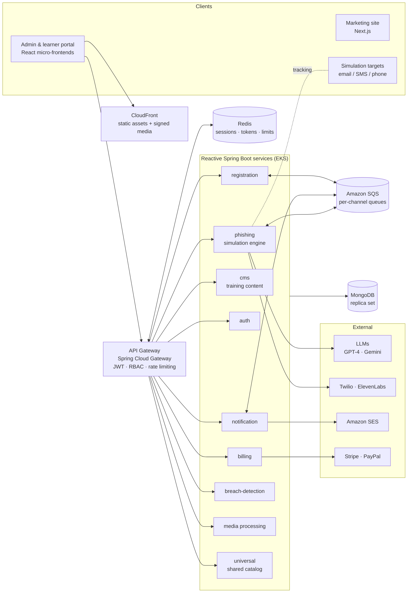
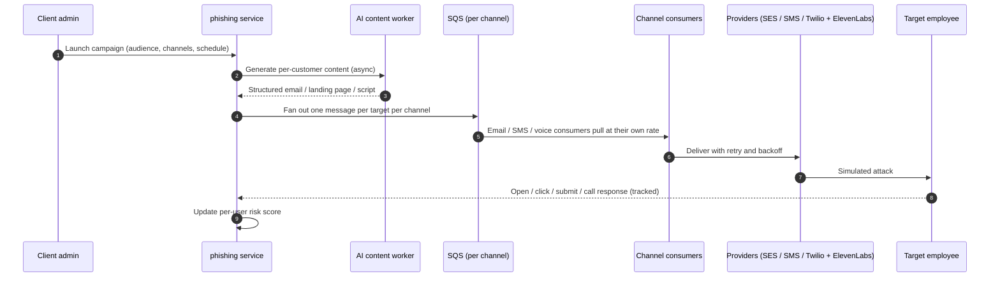
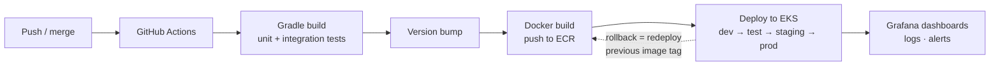

# Security-Awareness Training Platform: Architecture Case Study

> **What this is:** a write-up of a production SaaS platform that I lead as **Senior Software Engineer (Team Lead)** at Aspire Tech Services and Solutions, built for a US-based client.
> **What this is not:** source code. The code is proprietary, so this repository only documents the architecture, my decisions, and my ownership. Names, hostnames, and identifiers have been left out.

**My role:** I lead a team of 5 engineers. I own backend architecture, I'm the top contributor to the backend codebase, and I built nearly all of the infrastructure-as-code and CI/CD. I set the API contracts for the frontend team and mentored them on the micro-frontend architecture.

**Stack:** Java · Spring Boot 3 (WebFlux) · Spring Cloud Gateway · MongoDB · Redis · AWS (EKS, ECR, SQS, SES, S3, CloudFront, KMS, SSM, Secrets Manager, Route 53, ACM) · Terraform · Kubernetes · GitHub Actions · Grafana · k6 · React + TypeScript (Module Federation) · Next.js

---

## 1. The product

Companies use the platform to train employees to recognize social-engineering attacks, and to measure how vulnerable each employee is.

- **Simulations:** realistic phishing campaigns over **email, SMS, and voice calls**, plus deepfake media. Tracking measures who opens, clicks, submits credentials, or responds.
- **Training:** courses, exams, certificates, and micro-content assigned based on how each employee behaves.
- **Risk scoring:** per-user and per-organization risk scores built from simulation results, used in client security reports.
- **Breach monitoring:** watches for exposed credentials, exposed IPs, and company impersonation.
- **Commercial:** licenses, packages, invoices, and payments through **Stripe** and **PayPal**, including coupons, VAT, and discounts.
- **Multi-tenant hierarchy:** platform admins → managed service providers (MSPs) → client organizations → departments → learners, with six role levels.

## 2. System architecture

The backend is a **Gradle multi-module monorepo** with 10 deployable services. Every service is split the same way:

| Module | Contents | Why |
|---|---|---|
| `api` | DTOs and contracts only | Other services can depend on a contract without pulling in its implementation |
| `core` | Domain logic, repositories, integrations | Business rules stay testable and free of framework wiring |
| `service` | Boot application, controllers, config | The only part that changes per deployment |

Shared libraries (`common/core`, `common/api`, `common/observability`) give every service the same error model, security context, logging, and metrics.

### Services

| Service | Responsibility |
|---|---|
| **gateway** | One entry point. Validates JWTs, enforces per-route RBAC rules, applies Redis-backed rate limiting, forwards client IPs, writes audit logs, and aggregates OpenAPI docs |
| **auth** | Login, token issue and refresh, MFA (OTP), password policy (history, reset and set-token expiry), sessions in Redis |
| **registration** | Tenant hierarchy (MSPs, clients, departments), users, bulk onboarding, licenses |
| **phishing** | The simulation engine: campaigns, templates, landing pages, multi-channel delivery, tracking, risk scoring, AI content generation, deepfake and vishing flows |
| **cms** | Courses, exams, certificates, policies, knowledge hub, surveys, leaderboards |
| **billing** | Products, packages, invoices, Stripe and PayPal checkout and webhooks, coupons, VAT, manual payments |
| **notification** | Templated email, SMS, and in-app notifications over SES and Twilio |
| **breach-detection** | Breach findings, exposure scanning, impersonation monitoring |
| **vps** | Video and media processing for training and simulation content |
| **universal** | Shared reference data and catalog APIs used across services |

## 3. The campaign pipeline

Campaign delivery is the hardest part of the system. One campaign can target thousands of employees over three channels, each with different latency, cost, and failure behavior. External providers also rate-limit you.

**Decisions behind it:**

- **Separate queues and consumers per channel.** A slow voice provider or an SMS rate limit never holds up email delivery, and each channel scales and retries on its own.
- **Async workers for heavy jobs.** LLM generation, deepfake rendering, and speech-to-text for vishing responses all run on queues. API calls return immediately and never wait on a model.
- **Structured LLM output.** GPT-4 and Gemini return schema-constrained JSON, with tool calling, timeouts, retries, rate-limit handling, and token-cost controls. Swapping or falling back between providers doesn't affect the rest of the pipeline.
- **Tracking feeds a risk model.** Every interaction becomes an event that updates per-user and per-organization risk scores. Those scores drive the client reports and adaptive training.

More detail is in [docs/engineering-decisions.md](docs/engineering-decisions.md).

## 4. Infrastructure and delivery

I wrote and maintain the infrastructure as code. Everything is in **Terraform**: about 66 SQS queues, 19 ECR repositories with image-lifecycle policies, CloudFront distributions with origin access control and **signed URLs** for private media, SES domain identity with DKIM, ACM certificates, Route 53 records, and secrets in Secrets Manager, SSM Parameter Store, and KMS.

- **4 environments** (dev, test, staging, production) with Kubernetes manifests for each.
- **Versioned images.** Every release is an immutable tagged image, so rolling back means redeploying the previous tag.
- **Reliability:** a 3-node MongoDB replica set with automatic failover, k6 load tests before major releases, and Grafana dashboards with alerting for incident response.
- **Edge:** Nginx, TLS, and Cloudflare in front of supporting servers. Moving frontend assets to S3 + CloudFront cut JavaScript load time by about 50%.

## 5. Frontend architecture (team-built, I led the design)

The portal is a set of independently built **React + TypeScript** applications composed at runtime with **Vite Module Federation**. A host shell owns routing and layouts, and feature modules (users, content, phishing, billing, account, settings) load on demand as remotes. Each team area can ship on its own, and the backend `api` modules map one-to-one to the frontend feature boundaries.

The public marketing site is a separate **Next.js 14 + Tailwind** application.

## 6. Results

- A production multi-tenant SaaS with **10 backend services**, run by a **5-engineer team**
- **3 simulation channels** (email, SMS, voice) plus deepfake content, all running through one async pipeline
- **4 environments** fully defined in Terraform and deployed by CI/CD with one-step rollback
- **~50% faster** frontend load after moving assets to CloudFront

## 7. What I'd do next

- An outbox pattern for the database-write-then-enqueue steps, to guarantee at-least-once publishing
- Contract tests between the `api` modules and the frontend remotes
- Distributed tracing (OpenTelemetry) across gateway → service → queue → consumer

---

📫 More about me: [GitHub profile](https://github.com/shubhajit93) · [LinkedIn](https://www.linkedin.com/in/shubhajit-nandi/)

*For a runnable, open-source example of the same patterns, see [event-driven-campaign-platform](https://github.com/shubhajit93/event-driven-campaign-platform).*
